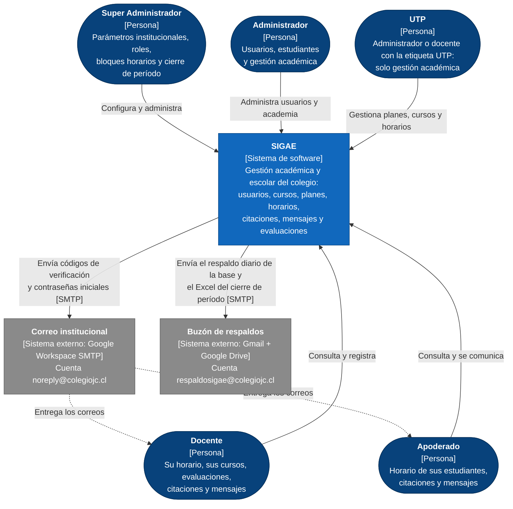
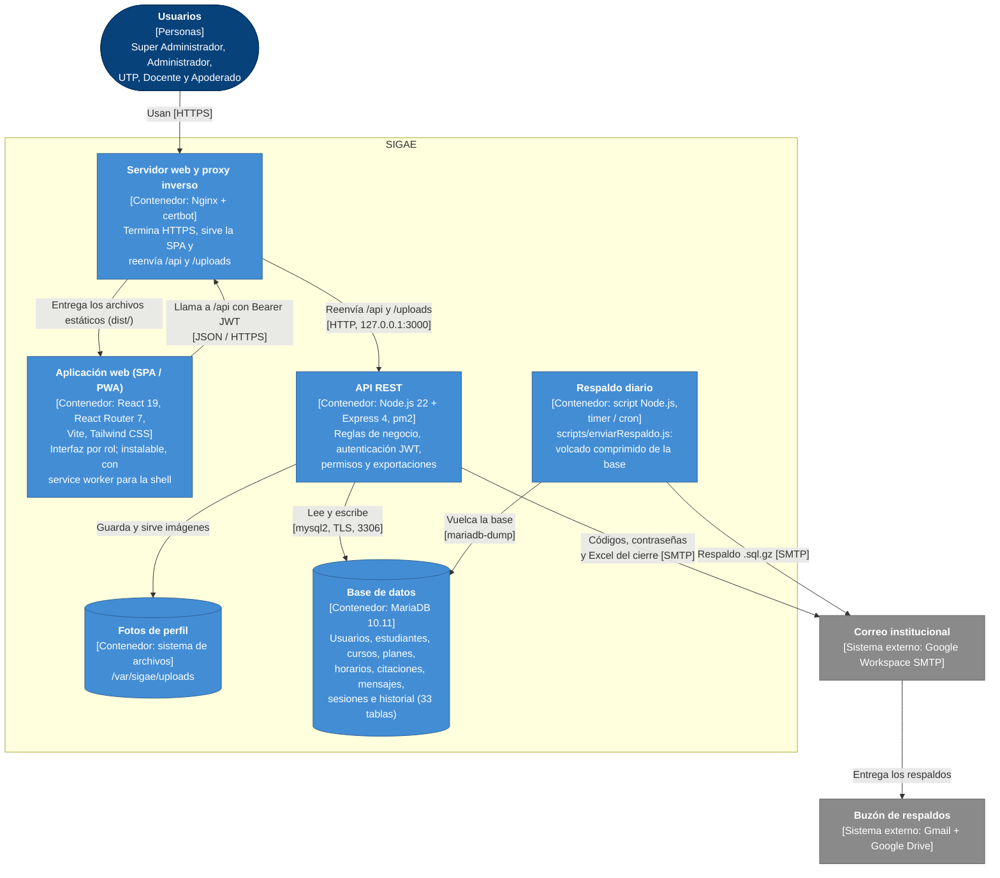
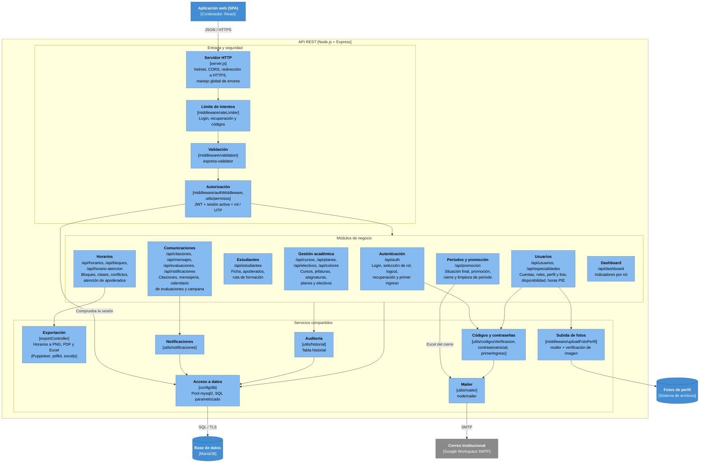
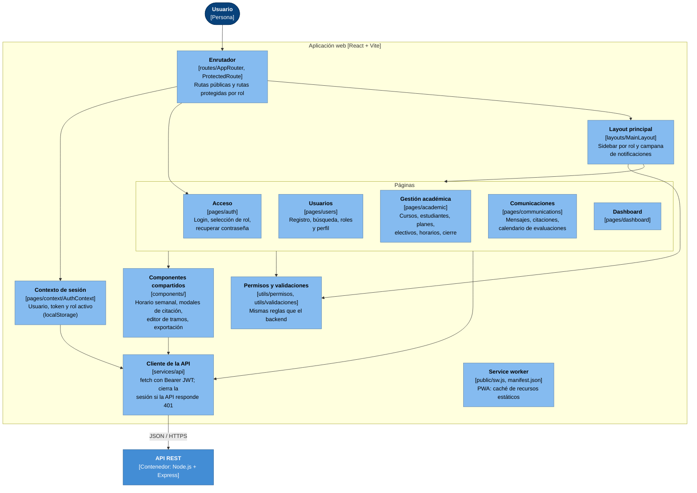
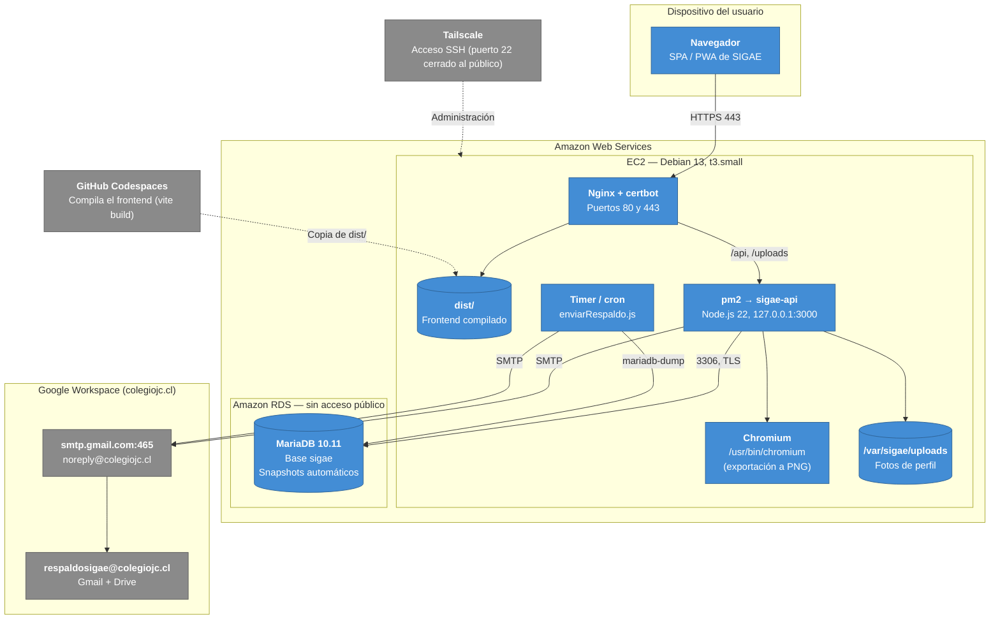

# Modelo C4 de SIGAE

Arquitectura de SIGAE (Sistema de Gestión Académica y Escolar) descrita con el
[modelo C4](https://c4model.com/): contexto, contenedores y componentes, más la
vista de despliegue de producción. Los diagramas están en Mermaid y GitHub los
dibuja directamente.

El nivel 4 (código) no se documenta: se lee del propio código. Lo marcado como
*por definir* en `docs/despliegue-produccion.txt` (dominio público, región de AWS)
tampoco aparece aquí.

Colores: azul oscuro = personas, azul = SIGAE, gris = sistemas externos.

---

## Nivel 1 — Contexto del sistema

Quién usa SIGAE y con qué sistemas externos se relaciona.

Notas:

- Los **estudiantes no son usuarios**: no inician sesión. Sus datos los gestiona
  la administración y los consultan docentes y apoderados.
- Una misma persona puede tener varios roles (por ejemplo, docente y apoderado) y
  elige con cuál entra después del login.
- Los códigos de verificación llegan a todos los usuarios; el diagrama solo
  dibuja dos entregas para no recargarlo.
- Los respaldos viajan por el mismo SMTP que los códigos; la copia a Google Drive
  la hace un filtro de Gmail, no SIGAE (`docs/respaldos-por-correo.md`).

---

## Nivel 2 — Contenedores

Las piezas ejecutables y de datos que forman SIGAE.

| Contenedor | Tecnología | Código | Responsabilidad |
| --- | --- | --- | --- |
| Servidor web y proxy | Nginx + certbot | (configuración en el servidor) | HTTPS, `/` → `dist/`, `/api` y `/uploads` → API. Único punto de entrada público. |
| Aplicación web | React 19, React Router 7, Vite 8, Tailwind 4 | `webSIGAE/FrontEnd/` | Interfaz de todos los roles. Se ejecuta en el navegador; guarda el JWT en `localStorage`. El service worker (`public/sw.js`) cachea solo recursos estáticos, nunca `/api` ni `/uploads`. |
| API REST | Node.js 22, Express 4, pm2 (`sigae-api`) | `webSIGAE/BackEnd/` | Toda la lógica de negocio. Genera exportaciones de horarios y el Excel del cierre de período (Puppeteer con Chromium del sistema, pdfkit, exceljs). |
| Respaldo diario | Node.js + `mariadb-dump` | `webSIGAE/BackEnd/scripts/enviarRespaldo.js` | Proceso aparte, programado: vuelca la base y la envía por correo con su SHA-256. |
| Base de datos | MariaDB 10.11 | `webSIGAE/Database/` | Estado del sistema. La API se conecta con un usuario sin DDL (`sigae_app`). |
| Fotos de perfil | Disco del servidor | `UPLOADS_DIR` | Imágenes subidas (hasta 5 MB). No las cubren los snapshots de la base. |

En **desarrollo** no hay Nginx: Vite sirve la SPA en `:5173` y su proxy reenvía
`/api` y `/uploads` a la API en `:3000`; la base es un MariaDB/MySQL local y, sin
`SMTP_HOST`, los códigos se muestran en la consola del backend.

---

## Nivel 3 — Componentes de la API REST

Cada módulo es un grupo de `routes/` + `controllers/` + `utils/` del backend.

| Componente | Archivos principales |
| --- | --- |
| Autenticación | `authController`, `passwordController`, `utils/sesion` (en `sesion` se guarda el hash SHA-256 del JWT) |
| Usuarios | `usuarioController`, `disponibilidadLaboralController`, `pieController`, `especialidadController` |
| Estudiantes | `estudianteController`, `apoderadosEstudianteController`, `utils/rutaFormacion` |
| Gestión académica | `cursoController`, `profesorJefeController`, `planController`, `electivoController`, `colorController`, `utils/tramos` |
| Horarios | `horarioController`, `bloquesController`, `conflictosHorarioController`, `horarioAtencionController`, `exportController` |
| Comunicaciones | `citacionController`, `solicitudCitacionController`, `mensajeController`, `evaluacionController`, `notificacionController` |
| Períodos y promoción | `promocionController`, `periodoController`, `utils/periodos`, `utils/situacionFinal`, `utils/limpiezaPeriodo` |
| Autorización | `verifyToken`, `verifyAdmin`, `verifyGestionAcademica`, `verifySuperAdmin`, `verifyPuedeCrearRol` |

No hay capa de repositorio ni ORM: los controladores ejecutan SQL parametrizado
directamente sobre el pool.

---

## Nivel 3 — Componentes de la aplicación web

Los permisos del frontend solo deciden **qué se muestra**; la API vuelve a
comprobar cada permiso en `authMiddleware` y en los controladores.

---

## Despliegue — Producción (marcha blanca)

Detalle paso a paso: [`despliegue-produccion.txt`](despliegue-produccion.txt).

---

## Mantener este documento

Actualízalo en el mismo commit cuando cambie algo de lo que dibuja:

- un rol nuevo o un sistema externo nuevo → nivel 1;
- un proceso, almacén de datos o servicio nuevo → nivel 2 y despliegue;
- un archivo nuevo en `routes/` montado en `server.js`, o una carpeta nueva en
  `FrontEnd/src/pages/` → nivel 3.
